# Plan S09: Enable Native iOS Action Sheet ("Take Photo or Choose Image") on `/ingest`

## 1. Goal Description

### Problem Statement & Context
On `/ingest` (`http://tasker-pi.local:8090/ingest`), tapping **"Tap to Take Cartridge Photo or Choose Image"** on an iPhone immediately opens the rear camera without presenting the option to select an existing photo from the iOS Photo Library or Files app.

In [`server/templates/ingest.html`](../../server/templates/ingest.html), the `#photo-file-input` element currently includes `capture="environment"`:
```html
<input id="photo-file-input" type="file" accept="image/*" capture="environment" class="hidden" onchange="onPhotoSelected(event)" />
```
According to the HTML Media Capture specification implemented by iOS Safari, the presence of the `capture` attribute instructs the mobile browser to bypass the native file/photo picker action sheet and launch the camera directly.

### Objectives
1. **Enable Native iOS Action Sheet**: Remove `capture="environment"` from `#photo-file-input` in [`server/templates/ingest.html`](../../server/templates/ingest.html) so iOS Safari presents the standard action sheet (**Photo Library**, **Take Photo**, **Choose File**).
2. **Red-Green Regression Test**: Add a regression assertion in [`server/tests/test_part_ingestor.py`](../../server/tests/test_part_ingestor.py) verifying that `#photo-file-input` renders `accept="image/*"` without a `capture=` attribute so mobile users can both take a photo and choose an existing image.

---

## 2. Architecture & Workflow Diagram

```mermaid
flowchart LR
    A["User taps 'Tap to Take Cartridge Photo or Choose Image' on iPhone"] --> B["<input id='photo-file-input' type='file' accept='image/*'> (no capture attribute)"]
    B --> C["iOS Safari Native Action Sheet"]
    C --> D1["📸 Take Photo (Camera)"]
    C --> D2["🖼️ Photo Library"]
    C --> D3["📁 Choose File"]
    D1 & D2 & D3 --> E["onPhotoSelected(event) -> POST /api/ingest/analyze-photo"]
```



---

## 3. Code Modifications

- **`[MODIFY]`** [`server/templates/ingest.html`](../../server/templates/ingest.html):
  - Line 100: Remove `capture="environment"` from `#photo-file-input`:
    ```html
    <input id="photo-file-input" type="file" accept="image/*" class="hidden" onchange="onPhotoSelected(event)" />
    ```

---

## 4. Test Updates & Specifications

- **`[MODIFY]`** [`server/tests/test_part_ingestor.py`](../../server/tests/test_part_ingestor.py):
  - **`test_ingest_view_renders_html()`**:
    - Assert `'id="photo-file-input" type="file" accept="image/*"' in res_empty.text` and `'capture=' not in res_empty.text` (reproducing the bug `RED` before the template edit and passing `GREEN` after).

---

## 5. Documentation Updates

- None required (internal template attribute bugfix).

---

## 6. Verification Plan

### Automated Tests
```bash
./Parts-Database/run_tests.sh
```

### Manual Verification
1. Deploy updated `Parts-Database` service to Node 02 (`tasker-pi.local:8090`) via `./Parts-Database/deploy.sh`.
2. Open **`http://tasker-pi.local:8090/ingest`** on iPhone Safari and tap **"Tap to Take Cartridge Photo or Choose Image"** to confirm the iOS sheet offers **Photo Library**, **Take Photo**, and **Choose File**.
