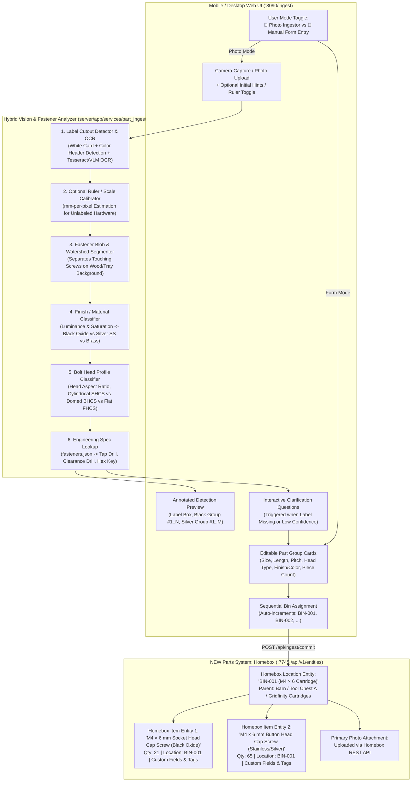

# Plan S07: Homebox Cartridge Photo & Form Parts Ingestor with CV Counting, Label OCR & Head Classification

## 1. Goal Description

### Context & Problem Statement
We are transitioning workshop inventory management to **Homebox (`:7745` on Node 02 `tasker-pi`)** as our new primary parts system (deployed under Plan M31). While cataloging our modular 3D-printed Gridfinity glass-window cartridges (`40x80 mm` cassettes), we need a streamlined **Parts Ingestor** web tool that allows rapid cataloging via **either**:
1. **Photo Ingestion Mode**: Taking or uploading a smartphone/camera photo of the spilled contents of a single cartridge (such as the example `M4 × 6` cartridge photo in `Temp/IMG_6334.jpeg`), or
2. **Direct Form Entry Mode**: Manually entering or selecting part specifications when a photo is not needed (user choice).

### Key Operational & Domain Requirements
1. **Target System (`Homebox :7745` Official `/api/v1` REST API)**:
   - All ingested cartridge bins and hardware items are committed via Homebox's official HTTP REST API (`http://tasker-pi.local:7745/api/v1`) — never via direct SQLite manipulation — so Homebox schema migrations and search indexes stay 100% safe.
   - **Deprecation of Legacy SQLite Parts Catalog**: The older standalone SQLite parts/bins/compartments catalog (`parts.db`, `/parts`, `/p/{id}`) is deprecated in favor of Homebox (`:7745`). The `:8090` service is retained specifically for the **Parts Ingestor (`/ingest`)**, **Standardized Label Generator (`/labels`)**, and **4-Digit QR Link Redirector (`/0001`, `/q/0001`, `/b/BIN-001`)**.
   - **No Sub-Bin Compartment Tracking**: Although physical cartridges have up to 3 internal divider spaces, we do not need to track which sub-slot (`C1`, `C2`, `C3`) a part occupies inside the cartridge.
   - **Separate Part Items per Finish/Variant in a Single Bin**: Distinct hardware variants within the same cartridge—such as **Black Oxide Socket Head Cap Screws (SHCS)** vs. **Silver/Stainless Button Head Cap Screws (BHCS)** in the `M4 × 6` photo—are cataloged as **separate Homebox Item entities** assigned to the **same sequential Cartridge Bin Location** (e.g., `BIN-001`).
2. **Sequential Temporary Bin Numbering (`BIN-001`, `BIN-002`, ...)**:
   - The ingestor automatically assigns the next available sequential bin number (`BIN-001`, `BIN-002`, `BIN-003`, ...) as a Homebox Location under `Barn` $\rightarrow$ `Tool Chest A` $\rightarrow$ `Gridfinity Cartridges` (or user-selected parent location).
   - Once all cartridges are cataloged, we can circle back to reassign permanent bin numbers and batch-print labels with contents and bin numbers.
3. **Label Cutout Detection & OCR + Interactive Clarification Questions**:
   - When a label cutout is present in the photo (like the blue-bordered `M4 × 6 / Pitch 0.7` label cutout in `IMG_6334.jpeg`), the ingestor automatically detects the white rectangular label card, reads the printed text (`M4 × 6`, `Pitch 0.7`), and populates the thread size, length, and pitch.
   - When no label is detected (or confidence is low), the ingestor makes an educated visual guess (using reference scale / ruler if present, or screw aspect ratios) and presents **interactive clarification questions** asking the user to confirm or select what the parts are (e.g., thread size, length, head type, finish).
4. **Hardware Clustering (Black vs. Silver), Piece Counting & Head Type Classification**:
   - Automatically segments individual fasteners from the wood/tray background, separates them into finish groups (**Black / Black Oxide** vs. **Silver / Stainless / Zinc**, or **Brass**), and counts the pieces in each group with an annotated visual badge overlay (`+` / `-` 1-tap override in UI).
   - Analyzes the head geometry/aspect profile of each bolt group to classify the **head type** (e.g., `Socket Head Cap (SHCS)` with cylindrical tall profile vs. `Button Head (BHCS)` with domed low-profile head vs. `Flat / Countersunk (FHCS)` vs. `Hex` / `Pan`) and pre-fills engineering specifications (`tap_drill`, `clearance_drill`, `tool_key`, `pitch`) from `hardware/labels/data/fasteners.json`.
5. **Optional Ruler / Scale Reference Calibration**:
   - Supports optional ruler / millimeter scale detection in frame (or a 1-tap interactive 2-point ruler calibration / `px-per-mm` reference) so the ingestor can estimate physical screw length (mm) and thread diameter (M2–M10) when no label cutout is included.
6. **Clean $12 \times 35\text{ mm}$ Vertical Split-Label Pair (`Label A` + `Label B`, Zero Bleed) & 4-Digit QR Forwarding Service (`/0001`)**:
   - Cartridges sit horizontally in storage drawers ($80\text{ mm}$ axis left-to-right), so each end label is oriented vertically at **$12.0\text{ mm}\text{ (W)} \times 35.0\text{ mm}\text{ (H)}$** with **zero bleed** for straight paper-cutter slicing (`[Label A | Label B]` = $24 \times 35\text{ mm}$ per cartridge pair).
   - **Label A (Part Identity End)**:
     - Top category color bar with the thread size (e.g. **`M4`**) overlaid on the color bar in large bold text.
     - Directly below the color bar: the bare length number (e.g. **`6`** — no `mm` unit suffix needed).
     - No `SHCS` / head designation and no icons on the label (since bins contain mixed head/finish types; head types are stored in Homebox).
     - Lower zone left blank by default, and only renders `extra_note` when explicitly provided for special details (e.g., non-standard pitch, self-tapping, lock nut designation).
   - **Label B (Bin & QR End)**:
     - Matching top category color bar.
     - Directly below the color bar: a **4-digit bin number** (e.g. **`0001`** — no `BIN` prefix text).
     - Below the bin number: a low-density QR code ($\le 25 \times 25$ modules, Version 1/2) encoding a compact forwarding URL (`HTTP://TASKER-PI.LOCAL:8090/0001`).
   - **QR Forwarding Service (`GET /{bin_code}` & `GET /q/{bin_code}` on `:8090`)**:
     - Translates the 4-digit bin ID (`0001`) via the forwarding table / live Homebox lookup into an `HTTP 302` redirect to the corresponding Homebox location (`http://tasker-pi.local:7745/location/<uuid>`) or fallback catalog view, with an interactive web UI editor on `/labels`.

---

## 2. Architecture & Workflow Diagram



---

## 3. Code Modifications

### 1. Dependencies & Vision / OCR Support
- **`[MODIFY]`** [`server/requirements.txt`](../../../server/requirements.txt):
  - Add `pillow>=10.0.0`, `numpy>=1.26.0`, and `opencv-python-headless>=4.10.0` for image segmentation, label card extraction, color clustering, head profile analysis, and annotated overlay rendering.
- **`[MODIFY]`** [`deploy.sh`](../../../deploy.sh):
  - Ensure `tesseract-ocr` is installed on Node 02 (`tasker-pi`) if missing and preserve `server/data/homebox_auth.json` and `server/data/qr_forwarding.json` across deployments.

### 2. Backend Services (`server/app/services/`)
- **`[NEW]`** [`server/app/services/homebox_service.py`](../../../server/app/services/homebox_service.py):
  - Manages reading and writing via Homebox v0.27.1's official REST API (`/api/v1/entities` and `/api/v1/entity-types`):
    - `get_next_sequential_bin_name() -> str`: Queries existing `BIN-XXX` locations in Homebox and returns the next sequential bin ID (`BIN-001`, `BIN-002`, ...).
    - `list_ingested_bins() -> List[Dict]`: Lists all cataloged `BIN-XXX` locations in Homebox along with their assigned hardware items, quantities, custom fields, and direct links to `http://tasker-pi.local:7745/location/{id}`.
    - `commit_cartridge_to_homebox(payload, photo_bytes=None) -> Dict`:
      1. Creates or reuses the parent `Barn > Tool Chest A > Gridfinity Cartridges` hierarchy in Homebox.
      2. Creates the sequential bin location entity (e.g., `BIN-001 — M4 × 6`).
      3. Creates separate Homebox `Item` entities for each hardware group in the cartridge (e.g. Black SHCS item and Silver BHCS item) with `quantity`, `description`, `notes`, custom fields, tags, and photo attachment.
    - `list_qr_forwarding_entries()`, `register_qr_forwarding_entry()`, `delete_qr_forwarding_entry()`: Manages `/0001` 4-digit QR forwarding URLs with manual override preservation (`preserve_existing=True`).
- **`[NEW]`** [`server/app/services/part_ingestor_service.py`](../../../server/app/services/part_ingestor_service.py):
  - `analyze_cartridge_photo(image_bytes: bytes, user_hints: Optional[Dict] = None, ruler_mm_per_px: Optional[float] = None) -> Dict`

### 3. API & Web Routes (`server/app/routes/`)
- **`[MODIFY]`** [`server/app/routes/api.py`](../../../server/app/routes/api.py):
  - `GET /api/ingest/next-bin`, `POST /api/ingest/analyze-photo`, `POST /api/ingest/commit`, `GET /api/ingest/history`, `GET /api/qr-forwarding`, `POST /api/qr-forwarding`, `DELETE /api/qr-forwarding/{bin_code}`.
- **`[MODIFY]`** [`server/app/routes/views.py`](../../../server/app/routes/views.py):
  - `GET /ingest`, `GET /labels`, `GET /{bin_code}`, `GET /q/{bin_code}`, `GET /b/{bin_code}`.
- **`[MODIFY]`** [`server/templates/base.html`](../../../server/templates/base.html) & [`server/templates/label_batch_export.html`](../../../server/templates/label_batch_export.html)
- **`[NEW]`** [`server/templates/ingest.html`](../../../server/templates/ingest.html)

---

## 4. Test Updates & Specifications

- **`[NEW]`** [`server/tests/test_part_ingestor.py`](../../../server/tests/test_part_ingestor.py)
- **`[MODIFY]`** [`server/tests/test_batch_label_generator.py`](../../../server/tests/test_batch_label_generator.py)

---

## 5. Documentation Updates

- **`[MODIFY]`** [`Parts-Database/README.md`](../../../README.md)
- **`[MODIFY]`** [`Parts-Database/hardware/labels/README.md`](../../../hardware/labels/README.md)
- **`[MODIFY]`** [`Parts-Database/docs/plans/AGENTS.md`](../AGENTS.md) & [`AGENTS.md`](../../../../AGENTS.md)

---

## 6. Verification Plan

### Automated Tests
```bash
cd "/Volumes/T9/Sync/Working/Server Rack/Parts-Database"
./run_tests.sh
```

### Manual Verification
1. Open the Parts Ingestor UI (`http://tasker-pi.local:8090/ingest`).
2. Verify Photo Ingestor and Manual Form Entry modes commit bins under `Barn > Tool Chest A > Gridfinity Cartridges` in Homebox (`http://tasker-pi.local:7745`).
3. Verify `http://tasker-pi.local:8090/0001` redirects to the Homebox location page (`/location/<uuid>`) and `/labels` provides the 4-Digit QR Forwarding Links editor.
