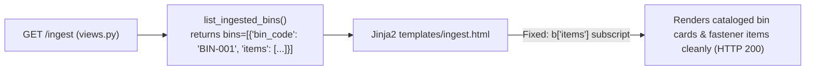

# Plan S08: Fix Jinja2 `dict.items` Collision on `/ingest` When Homebox Bins Are Populated

## 1. Goal Description

### Problem Statement & Context
When `GET /ingest` (`http://tasker-pi.local:8090/ingest`) is requested after one or more cartridge bins (`BIN-001`, etc.) have been saved into Homebox, the endpoint returns `HTTP 500 Internal Server Error`:
```text
File "/opt/parts-database/server/templates/ingest.html", line 247, in block 'content'
  
TypeError: 'builtin_function_or_method' object is not iterable
```
Because each entry `b` in `ingested_bins` is a Python `dict` containing an `"items"` list key, Jinja2 attribute lookup `b.items` resolves to the built-in `dict.items` method rather than `b["items"]`.

### Objectives
1. **Fix Template Dictionary Subscript**: Replace `` with `` in [`server/templates/ingest.html`](../../../server/templates/ingest.html).
2. **Red-Green Regression Test**: Update `test_ingest_view_renders_html()` in [`server/tests/test_part_ingestor.py`](../../../server/tests/test_part_ingestor.py) to commit a populated bin to Homebox before requesting `GET /ingest`, reproducing the failure (`RED`) and verifying the fix (`GREEN`).

---

## 2. Architecture & Workflow Diagram



---

## 3. Code Modifications

- **`[MODIFY]`** [`server/templates/ingest.html`](../../../server/templates/ingest.html):
  - Line 247: Changed `` to ``.

---

## 4. Test Updates & Specifications

- **`[MODIFY]`** [`server/tests/test_part_ingestor.py`](../../../server/tests/test_part_ingestor.py):
  - **`test_ingest_view_renders_html()`**:
    - Commits a populated bin (`BIN-001` with `M4 × 6 mm Socket Head Cap Screw`, `quantity: 25`) via `POST /api/ingest/commit` and then requests `GET /ingest`.
    - Asserts `res.status_code == 200`, `"BIN-001"` in `res.text`, and `"25 pcs"` in `res.text`.

---

## 5. Documentation Updates

- None required (internal template bugfix).

---

## 6. Verification Plan

### Automated Tests
```bash
./Parts-Database/run_tests.sh
```

### Manual Verification
1. Deployed `Parts-Database` to Node 02 (`tasker-pi.local:8090`) via `./Parts-Database/deploy.sh`.
2. Verified **`http://tasker-pi.local:8090/ingest`** returns `HTTP 200 OK` and displays cataloged Homebox bins.
