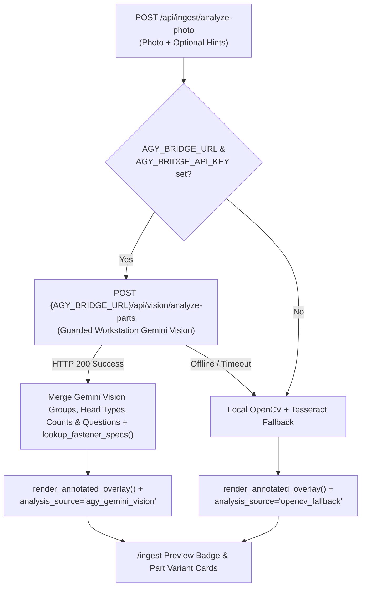

# Plan S10: AGY / Gemini Vision Callback Integration for Cartridge Photo Parts Ingestor (`/ingest`)

## 1. Goal Description

### Problem Statement & Context
In [`server/app/services/part_ingestor_service.py`](../../../server/app/services/part_ingestor_service.py), `analyze_cartridge_photo()` currently performs only local OpenCV color-thresholding and `tesseract`/template OCR. It never calls the Workstation Antigravity Bridge (`agy_bridge_server.py` on `:8765`), causing it to miss obvious hardware characteristics, hard-default black oxide hardware to `"shcs"`, fail to identify nuts/washers/countersunk screws/hex bolts/brass inserts, and fall back to `M4 × 6 mm` whenever a blue/orange paper cutout is absent.

Paired with [`Macro Plan M36`](../../../../docs/plans/complete/2026-11-14-M36_agy_gemini_vision_part_ingestor_macro_plan.md) and [`Personal-Assistant Plan 37`](../../../../Personal-Assistant/docs/plans/complete/2026-11-14-37_agy_bridge_vision_endpoint_and_guardrails_plan.md), this plan upgrades `Parts-Database` `/ingest` to invoke the guarded `POST /api/vision/analyze-parts` endpoint on `agy_bridge` so Gemini Vision performs the primary image analysis (with automatic fallback to local OpenCV if the workstation bridge is offline).

### Objectives
1. **AGY Vision Callback in `part_ingestor_service.py`**:
   - Add `call_agy_vision_part_analyzer(image_bytes, user_hints, ruler_mm_per_px)` in [`server/app/services/part_ingestor_service.py`](../../../server/app/services/part_ingestor_service.py) using `AGY_BRIDGE_URL` (or `LLM_HOST`) and `AGY_BRIDGE_API_KEY`.
   - In `analyze_cartridge_photo()`, invoke `call_agy_vision_part_analyzer()` when `AGY_BRIDGE_URL` / `AGY_BRIDGE_API_KEY` is configured:
     - Merge Gemini Vision's detected label specs (`size`, `length`, `pitch`), hardware groups (`comp_type`, `head`, `drive`, `finish`, `finish_key`, `quantity`, `notes`), and clarification questions with canonical engineering lookups from `lookup_fastener_specs()` (`tap_drill`, `clearance_drill`, `tool_key`) and the annotated preview overlay.
     - Mask out any edge ruler (`_detect_edge_ruler_mask` + `ruler_bbox_pct`), localize the paper label card via its colored header bar (`detect_and_read_label_cutout`), and align piece badge counts (`target_counts`) with Gemini Vision's counts.
     - Return `"analysis_source": "agy_gemini_vision"` (or `"opencv_fallback"` when the bridge is unconfigured or unreachable).
2. **Surface Analysis Engine Badge in `/ingest` UI (`server/templates/ingest.html`)**:
   - Update [`server/templates/ingest.html`](../../../server/templates/ingest.html) to display whether the photo was analyzed by **`🤖 AGY Gemini Vision`** or **`📷 Local CV`** in `#preview-status-badge`.
3. **Hermetic Unit & Integration Tests (`server/tests/test_part_ingestor.py`)**:
   - Add Red-Green tests verifying that `analyze_cartridge_photo()` calls `POST /api/vision/analyze-parts` when configured, properly maps Gemini Vision classifications (including non-SHCS black hardware, nuts, washers, countersunk screws, and custom labels), masks out edge rulers (`test_ruler_exclusion_and_vision_bbox_overlay_on_img_6354`), and falls back cleanly to local OpenCV when the bridge is unreachable.

---

## 2. Architecture & Workflow Diagram



---

## 3. Code Modifications

### Component 1: AGY Vision Client & Hybrid Analyzer (`server/app/services/part_ingestor_service.py`)
- **`[MODIFY]`** [`server/app/services/part_ingestor_service.py`](../../../server/app/services/part_ingestor_service.py):
  1. Add `get_agy_bridge_config() -> Tuple[Optional[str], Optional[str]]`:
     - Reads `AGY_BRIDGE_URL` (or `LLM_HOST`) and `AGY_BRIDGE_API_KEY` from environment variables, `/opt/assistant/.env`, or `~/.config/agy_bridge/api_key`.
  2. Add `call_agy_vision_part_analyzer(image_bytes: bytes, user_hints: Optional[Dict[str, Any]] = None, ruler_mm_per_px: Optional[float] = None) -> Optional[Dict[str, Any]]`:
     - Sends `{"image_base64": ..., "size_hint": ..., "length_hint": ..., "ruler_mm_per_px": ...}` to `POST {bridge_url}/api/vision/analyze-parts` with `Authorization: Bearer <api_key>`.
     - Returns the validated `analysis` dictionary on HTTP `200`, or `None` on network/timeout errors so `analyze_cartridge_photo()` seamlessly falls back to local OpenCV.
  3. Update `detect_and_read_label_cutout()`, `segment_and_classify_fasteners()`, and `analyze_cartridge_photo()`:
     - Anchors label cutout detection on blue/orange category header bars so paper cards on light wood grain are accurately boxed.
     - Masks out edge rulers (`_detect_edge_ruler_mask` and `ruler_bbox_pct`) and aligns piece badge counts (`target_counts`) with Gemini Vision's group counts.
     - Calls `call_agy_vision_part_analyzer()` first and sets `"analysis_source": "agy_gemini_vision"` (or `"opencv_fallback"`).

### Component 2: `/ingest` Template Status Badge (`server/templates/ingest.html`)
- **`[MODIFY]`** [`server/templates/ingest.html`](../../../server/templates/ingest.html):
  - Include an `[🤖 AGY Gemini Vision]` or `[📷 Local CV]` prefix in `#preview-status-badge` after photo analysis completes.

---

## 4. Test Updates & Specifications

- **`[MODIFY]`** [`server/tests/test_part_ingestor.py`](../../../server/tests/test_part_ingestor.py):
  1. `test_analyze_cartridge_photo_uses_agy_gemini_vision_callback(monkeypatch)`
  2. `test_analyze_cartridge_photo_falls_back_to_opencv_when_agy_bridge_offline(monkeypatch)`
  3. `test_ruler_exclusion_and_vision_bbox_overlay_on_img_6354(monkeypatch)`

---

## 5. Documentation Updates
- **`[MODIFY]`** [`README.md`](../../../README.md):
  - Update the Cartridge Parts Ingestor (`/ingest`) description to document the `agy_bridge` Gemini Vision callback and fallback pipeline.

---

## 6. Verification Plan

### Automated Tests
```bash
./Parts-Database/run_tests.sh
```

### Manual Verification
1. Deploy `Parts-Database` to `tasker-pi.local:8090` via `./Parts-Database/deploy.sh` with `AGY_BRIDGE_URL` and `AGY_BRIDGE_API_KEY` configured.
2. Open `http://tasker-pi.local:8090/ingest`, upload a cartridge photo, and verify the **`[🤖 AGY Gemini Vision]`** badge appears, the ruler is ignored, the label cutout is boxed in green, and the hardware groups/counts/head types are populated by Gemini Vision.
