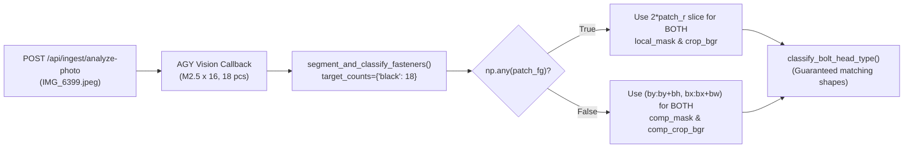

# Plan S12: Fix Multi-Screw Cluster Patch Mask Shape Mismatch in `classify_bolt_head_type` (`IMG_6399.jpeg`)

## 1. Goal Description

### Problem Statement & Root Cause
When uploading `Temp/IMG_6399.jpeg` (`M2.5 × 16` Pitch `0.45` Black Oxide SHCS screws on a woven mat) to `POST /api/ingest/analyze-photo`, the Workstation `agy_bridge` (`:8765/api/vision/analyze-parts`) succeeds (`HTTP 200`, `count = 18`), and then `analyze_cartridge_photo()` calls `segment_and_classify_fasteners(..., target_counts={"black": 18, "silver": 0})` to place numbered visual badges on the image.

Inside `_extract_pieces_from_mask()` in [`server/app/services/part_ingestor_service.py`](../../../server/app/services/part_ingestor_service.py):
- When `est_count` (`target_counts`) assigns multiple screws to a large connected component (`comp_mask` of shape `bh × bw`, e.g., `165 × 140` pixels) and extracts a `2 * patch_r` local window (`crop_bgr` of shape `22 × 22` pixels) around a candidate peak `(px, py)` where `np.any(patch_fg)` is `False` (or when `local_mask` falls back to `comp_mask`), `local_mask` has shape `(165, 140)` while `crop_bgr` has shape `(22, 22, 3)`.
- Passing `(local_mask, crop_bgr)` to `classify_bolt_head_type()` executes `gray[component_mask > 0]`, raising:
  `IndexError: boolean index did not match indexed array along axis 0; size of axis is 22 but size of corresponding boolean axis is 165`.

### Objectives
1. Fix `_extract_pieces_from_mask()` so that when `np.any(patch_fg)` is `True`, `local_mask` and `crop_bgr` both use the `(y1:y2, x1:x2)` slice, and when `np.any(patch_fg)` is `False`, both `local_mask` and `crop_bgr` use the full component bounding box `(by:by+bh, bx:bx+bw)`.
2. Add a defensive shape check inside `classify_bolt_head_type()` so `gray[component_mask > 0]` is only evaluated when `gray.shape == component_mask.shape`.

---

## 2. Architecture & Workflow Diagram



---

## 3. Code Modifications

- **`[MODIFY]`** [`server/app/services/part_ingestor_service.py`](../../../server/app/services/part_ingestor_service.py):
  - In `classify_bolt_head_type()`: verify `crop_bgr.size > 0` and `gray.shape == component_mask.shape` before indexing `gray[component_mask > 0]`.
  - In `_extract_pieces_from_mask()`: when `np.any(patch_fg)` is `False`, set `crop_bgr = work[by : by + bh, bx : bx + bw]` alongside `local_mask = comp_mask` so their shapes always match.

---

## 4. Test Updates & Specifications

- **`[MODIFY]`** [`server/tests/test_part_ingestor.py`](../../../server/tests/test_part_ingestor.py):
  - Add `test_img_6399_multi_screw_cluster_patch_mask_shape_regression(monkeypatch)`:
    - Reproduces the exact `target_counts={"black": 18, "silver": 0}` call on `Temp/IMG_6399.jpeg` (plus a synthetic large-cluster test when `Temp/IMG_6399.jpeg` is absent) and verifies `analyze_cartridge_photo()` succeeds without `IndexError` and returns `M2.5 × 16` (`18` pcs).

---

## 5. Documentation Updates

- None required (internal bugfix).

---

## 6. Verification Plan

### Automated Tests
```bash
./Parts-Database/run_tests.sh
```

### Manual Verification
1. Deploy updated `Parts-Database` to `tasker-pi.local` via `./Parts-Database/deploy.sh`.
2. Re-run `POST http://tasker-pi.local:8090/api/ingest/analyze-photo` with `Temp/IMG_6399.jpeg` and confirm `HTTP 200` response.
