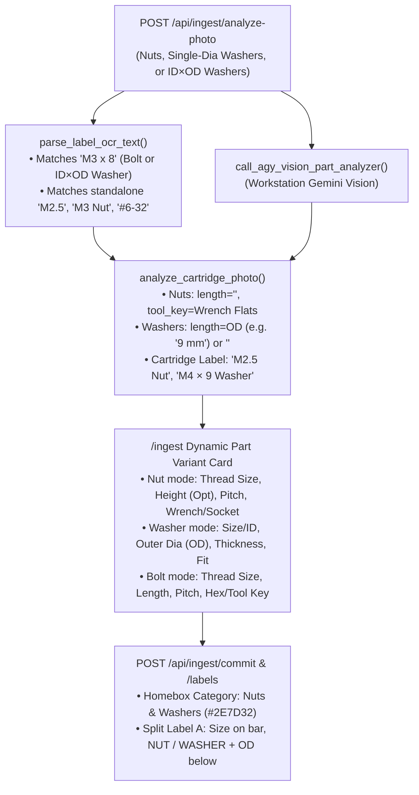

# Plan S11: Nut & Dual-Diameter Washer Support in Cartridge Parts Ingestor (`/ingest` & `/labels`)

## 1. Goal Description

### Problem Statement & Context
Paired with [`Macro Plan M41`](../../../../docs/plans/complete/2026-11-17-M41_nut_and_dual_diameter_washer_ingestor_support_macro_plan.md), the Cartridge Parts Ingestor (`/ingest`) in `Parts-Database` previously failed when ingesting photos or form entries of **nuts** and **washers** (including dual-diameter ID × OD washers):
1. `analyze_cartridge_photo()` in [`server/app/services/part_ingestor_service.py`](../../../server/app/services/part_ingestor_service.py) forced `resolved_length = ... or "6 mm"` even when the hardware was a nut or single-diameter washer.
2. `parse_label_ocr_text()` required `M<size> x <length>`, failing on nut or washer label cutouts that print only a size (`M2.5`, `M3`, `M4`, `#6-32`) without `× <length>`.
3. `lookup_fastener_specs()` returned the internal SHCS Allen key (`2.0 mm` for `M2.5`) instead of the ISO/DIN/ANSI external hex nut wrench size across flats (`5.0 mm` for `M2.5`, `5.5 mm` for `M3`, `7.0 mm` for `M4`, `8.0 mm` for `M5`, `10.0 mm` for `M6`, etc.).
4. `build_clarification_questions()` asked *"What is the thread length of these fasteners?"* on nuts, and did not prompt for Outer Diameter (OD) when a washer's second diameter was needed.
5. In [`server/templates/ingest.html`](../../../server/templates/ingest.html), `rebuildGroupName()` appended `" Screw"` to every dropdown option (generating `"M2.5 × 6 mm Hex Nut Screw"`), did not update `comp_type` when switching head/component type, and did not adapt field labels for **Washers** (`Size / Inner Dia (ID)` + `Outer Dia (OD)`) vs **Nuts** (`Thread Size` + `Wrench / Socket`).
6. In [`server/app/services/homebox_service.py`](../../../server/app/services/homebox_service.py) and [`hardware/labels/canonical_label.py`](../../../hardware/labels/canonical_label.py), dual-diameter washers (`M4 × 9 mm Flat Washer`) were excluded from the `nuts_washers` (`#2E7D32` green) category because `not length` was required, and 12×35mm vertical split labels needed `"WASHER"` printed in bold on every washer label with known OD sizes (`"9mm"`, `"20mm"`, etc.) listed underneath.

---

## 2. Architecture & Workflow Diagram



---

## 3. Code Modifications

### Component 1: Fastener Ingestor Service (`server/app/services/part_ingestor_service.py`)
- **`[MODIFY]`** [`server/app/services/part_ingestor_service.py`](../../../server/app/services/part_ingestor_service.py):
  1. Added `NUT_HEAD_TYPES = {"nut", "nyloc", "flange_nut", "square_nut", "wing_nut", "tnut", "tnut_pre", "tnut_post"}` and `WASHER_HEAD_TYPES = {"washer", "fender_washer", "split_washer"}` plus `HEAD_DISPLAY_NAMES` mapping all bolt, nut, washer, and insert types cleanly without appending `"Screw"` to non-screws.
  2. Updated `lookup_fastener_specs(size, head, drive)`:
     - Included ISO/DIN metric and ASME imperial external hex nut wrench sizes across flats (`NUT_WRENCH_FLATS_MAP`: `M1.6: 3.2 mm`, `M2: 4.0 mm`, `M2.5: 5.0 mm`, `M3: 5.5 mm`, `M4: 7.0 mm`, `M5: 8.0 mm`, `M6: 10.0 mm`, `M8: 13.0 mm`, `M10: 16.0 mm`, `M12: 18.0 mm`, `#4-40: 1/4"`, `#6-32: 5/16"`, `#8-32: 11/32"`, `#10-24: 3/8"`, `#10-32: 3/8"`, `1/4"-20: 7/16"`, `5/16"-18: 1/2"`, `3/8"-16: 9/16"`).
     - When `head in NUT_HEAD_TYPES`, returns external wrench size as `tool_key` and `tap_drill: ""`.
     - When `head in WASHER_HEAD_TYPES`, returns `tool_key: ""`, `pitch: ""`, `tap_drill: ""`, and standard washer clearance ID in `clearance_drill`.
  3. Updated `parse_label_ocr_text(raw_text)`:
     - Supports dual-diameter or `ID x OD x Thickness` washer strings (`M3 x 7`, `M4 x 9 x 0.8`, `3.2 x 7 mm`) as well as standalone metric/imperial sizes without `x <length>` (`M2.5`, `M3`, `M4`, `#6-32`, `1/4"-20` when printed on nut/washer labels).
  4. Updated `build_clarification_questions()`:
     - When all detected groups are nuts (`comp_type == "nut"` or `head in NUT_HEAD_TYPES`), does **not** ask for bolt thread length.
     - When groups are washers (`comp_type == "washer"` or `head in WASHER_HEAD_TYPES`) and `length` (Outer Diameter OD) is unknown, asks an optional washer Outer Diameter question (`"What is the Outer Diameter (OD) of these washers, if applicable?"` with common OD options + `"Standard (Size Only)"`).
  5. Updated `analyze_cartridge_photo()` and `render_annotated_overlay()`:
     - Never forces `"6 mm"` onto nuts or single-diameter washers.
     - Formats `name` and `cartridge_label` accurately (`"M2.5 Hex Nut (Black Oxide Steel)"`, `"M2.5 Nut"`, `"M4 × 9 mm Flat Washer (Stainless Steel (Silver))"`, `"M4 × 9 Washer"`).

### Component 2: Ingest UI Template (`server/templates/ingest.html`)
- **`[MODIFY]`** [`server/templates/ingest.html`](../../../server/templates/ingest.html):
  - Expanded `HEAD_OPTIONS` with `nut`, `nyloc`, `flange_nut`, `square_nut`, `tnut_pre`, `tnut_post`, `tnut`, `washer`, `fender_washer`, `split_washer`, and `insert`.
  - Added `resolveFinishForGroup(g)` and `Nickel Plated (Silver)` to `FINISH_OPTIONS` so Gemini Vision finish strings and `finish_key` values always populate and select the matching `<option>` in `#grp-finish-${idx}`.
  - Fixed `rebuildGroupName(idx)` and `updateCartridgeSummaryLabel()` so nuts and washers never get `" Screw"` appended and only include `× <length/OD>` when a second dimension is actually present.
  - Dynamically updates the 4 input field labels on each Part Variant Card based on component type (`Washer` vs `Nut` vs `Bolt / Screw`).

### Component 3: Homebox & Label Service Integration (`server/app/services/homebox_service.py` & `hardware/labels/canonical_label.py`)
- **`[MODIFY]`** [`server/app/services/homebox_service.py`](../../../server/app/services/homebox_service.py):
  - Updated `commit_cartridge_to_homebox()` and `_extract_cartridge_specs_from_homebox_bin()` so nuts and washers (including dual-diameter washers with an OD in `length`) map to `category_id = "nuts_washers"` (`#2E7D32`) and format descriptions without spurious `×` when `length` is empty.
  - Aggregates all known Outer Diameters (ODs) across multi-washer bins in ascending numerical order (`"9mm, 20mm"` on `BIN-053`, `"7mm, 15mm"` on `BIN-055`, `"20mm, 25mm, 30mm"` on `BIN-056`, `"5mm"` on `BIN-052`) and omits any washer item whose OD is unknown.
  - Optimized `resolve_homebox_paths()` and `list_ingested_bins()` for sub-second `/labels` rendering:
    - Routes server-to-server Homebox API requests on `tasker-pi` over loopback (`http://127.0.0.1:7745/api/v1`) when `base_url` points to `tasker-pi.local:7745` on the local host.
    - Computes `cartridges_root_id` and `next_bin_id` directly from the already-fetched `locations` list in `list_ingested_bins()` (reducing Homebox API round-trips from 4 to 2).
    - Loads `qr_forwarding.json` once before iterating over `bin_locs` and writes once only if dirty.
- **`[MODIFY]`** [`hardware/labels/data/fasteners.json`](../../../hardware/labels/data/fasteners.json), [`server/app/services/label_service.py`](../../../server/app/services/label_service.py), [`server/app/routes/views.py`](../../../server/app/routes/views.py), and [`server/templates/label_batch_export.html`](../../../server/templates/label_batch_export.html):
  - Consolidated bin and label color taxonomy (`#0077CC` Blue Metric, `#E65100` Orange Imperial, `#2E7D32` Green Nuts & Washers, `#D4A017` Yellow Heat-Set Inserts/Standoffs).
  - Wrapped `list_ingested_bins` in `asyncio.to_thread` in `views.py`.
- **`[MODIFY]`** [`hardware/labels/canonical_label.py`](../../../hardware/labels/canonical_label.py):
  - Added `_estimate_svg_text_width()` for wide uppercase glyph keepout scaling.
  - In `render_vertical_split_label_pair_svg()`:
    - Renders `"NUT"` / `"NYLOC"` / `"T-NUT"` / `"SQUARE NUT"` below the color bar on Label A for nuts.
    - Always renders `"WASHER"` in bold (`1.92 mm`) below the color bar on every washer label, and lists known OD sizes (`"5mm"`, `"9mm"`, `"20mm"`, etc.) underneath.

---

## 4. Test Updates & Specifications

- **`[MODIFY]`** [`server/tests/test_part_ingestor.py`](../../../server/tests/test_part_ingestor.py) & [`server/tests/test_batch_label_generator.py`](../../../server/tests/test_batch_label_generator.py):
  1. `test_analyze_cartridge_photo_nuts_and_dual_diameter_washers(monkeypatch)`
  2. `test_parse_label_ocr_text_standalone_nut_and_dual_diameter_washer()`
  3. `test_extract_cartridge_specs_multi_washer_bin_aggregates_known_ods_with_mm()`
  4. `test_resolve_homebox_paths_uses_loopback_for_local_tasker_pi()`
  5. `test_vertical_split_label_pair_svg_washer_with_and_without_od()`

---

## 5. Documentation Updates
- **`[MODIFY]`** [`docs/plans/AGENTS.md`](../AGENTS.md): Updated `S11` to `ARCHIVED` in the `Parts-Database` Master Plan Registry.

---

## 6. Verification Plan

### Automated Tests
```bash
./Parts-Database/run_tests.sh
```

### Manual Verification
1. Deployed to `tasker-pi.local:8090` via `./Parts-Database/deploy.sh`.
2. Verified nut and dual-diameter washer ingestion on `http://tasker-pi.local:8090/ingest`, verified `"WASHER"` + OD (`"5mm"`, `"9mm"`, `"20mm"`) labels on `http://tasker-pi.local:8090/labels`, updated `BIN-052` (`M2.5 × 5 mm Flat Washer`), and repurposed duplicate `BIN-043` into `30× M3 × 12 mm Button Head Cap Screw (Stainless Steel (Silver))`.
