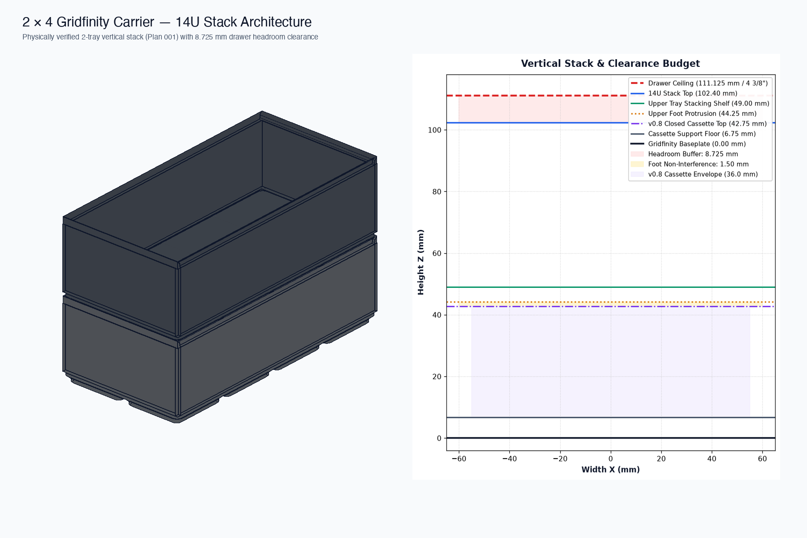
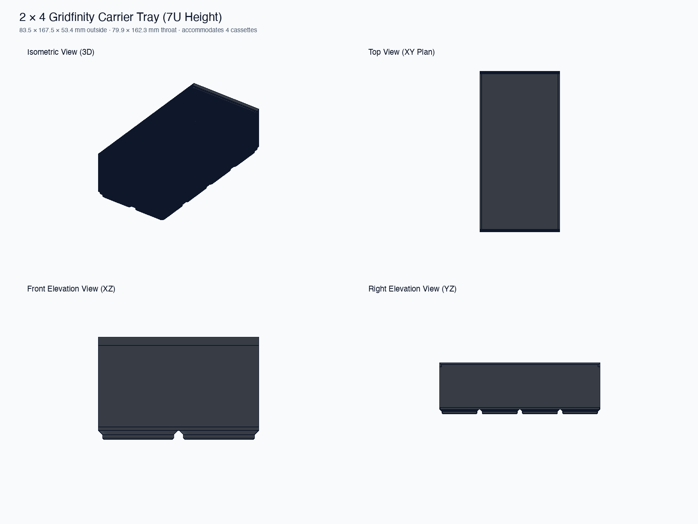

# 2 × 4 Gridfinity carrier — 14U physical test release v0.1

This 4-cassette carrier variant uses **two identical 7U carriers** on a **2 × 4 Gridfinity footprint** ($83.5 \times 167.5 \times 53.4\text{ mm}$). Printing two copies of `build/carrier_2x4_7u_v0_1.stl` forms a 14U stack with a nominal overall height of $102.4\text{ mm}$ including the exposed top stacking lip, leaving $8.725\text{ mm}$ nominal clearance inside the $111.125\text{ mm}$ drawer.

## Geometric Specifications

| Parameter | Dimension | Notes |
|---|---:|---|
| Gridfinity footprint | $2 \times 4\text{ U}$ ($42.0\text{ mm}$ pitch) | $83.50 \times 167.50\text{ mm}$ outer dimensions |
| Height per carrier | $7\text{ U}$ ($49.0\text{ mm}$ engaged / $53.4\text{ mm}$ total) | $102.4\text{ mm}$ 2-tray 14U stack height |
| Cassette capacity | 4 cassettes ($2\text{-across} \times 2\text{-deep}$) | Compatible with v0.8 cassettes ($39.75 \times 80.0 \times 36.4\text{ mm}$) |
| Working throat ($X \times Y$) | $79.90 \times 162.30\text{ mm}$ | $+0.40\text{ mm}$ lateral clearance at v0.8 hinge knuckles ($+2.70\text{ mm}$ across lower $38.6\text{ mm}$ bodies) |
| Outer wall thickness ($X$ / $Y$) | $1.80\text{ mm}$ ($X$) / $2.60\text{ mm}$ ($Y$) | 4 solid perimeters in $X$ ($0.45\text{ mm}$ width); continuous solid walls |
| Support floor / engagement plane | $Z = 6.75\text{ mm}$ / $Z = 49.00\text{ mm}$ | Matches verified $3 \times 4$ carrier vertical datum |

## Print set

| File | Quantity | Purpose |
|---|---:|---|
| `build/carrier_2x4_7u_v0_1.stl` | 1–2 | Printable 2 × 4 × 7U carrier tray |
| `build/REFERENCE_two_carrier_14u_stack_DO_NOT_PRINT.stl` | 0 | CAD/slicer height reference only |

Print upright as supplied in PETG or PLA. Recommended settings: $0.4\text{ mm}$ nozzle, $0.20\text{ mm}$ layers, 4 perimeters ($0.45\text{ mm}$ extrusion width produces solid $1.80\text{ mm}$ $X$-walls without gap infill), and no internal support.

## Physical checks to record

1. Load four closed v0.8 cassettes ($2 \times 2$) into the tray and check insertion, removal via pull tabs, hinge-knuckle clearance, and rattle.
2. Verify seating on existing Gridfinity baseplates in the target drawer.
3. Check top-lip stacking engagement (with a second $2 \times 4$ tray or mixed with a $3 \times 4$ tray) and confirm that upper Gridfinity feet clear the cassette lids and pull tabs.

Record test results in [`PHYSICAL_TEST_NOTES.md`](PHYSICAL_TEST_NOTES.md).

Regenerate with `python3 generate_carrier.py`.
